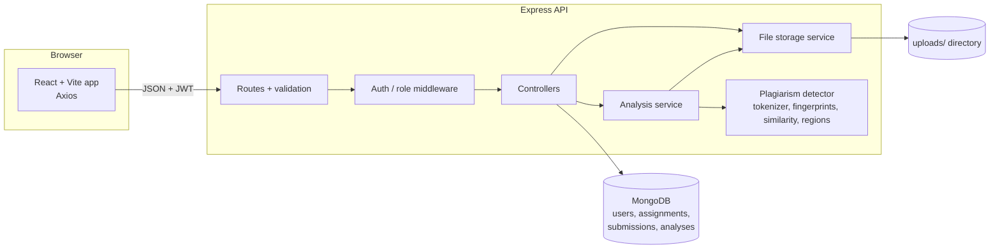

# CodeGuard: Programming Assignment Plagiarism Detection System

CodeGuard lets professors create programming assignments, lets students upload Java or Python source files, and lets professors analyse the latest submissions of an assignment for **suspicious similarity**.

> **Important:** CodeGuard measures similarity. It does **not** prove plagiarism. Independent solutions to short or tightly specified assignments can look alike. A flagged pair means "a human should read these two files", and nothing more. The status used for flagged pairs is `REVIEW_REQUIRED`; there is deliberately no "proven" status.

Everything is JavaScript. The detector runs fully offline, with no paid API, no AI service and no external plagiarism engine. Uploaded code is only ever read as text and is never executed.

## Features

- Registration, login (JWT, bcrypt-hashed passwords) and a protected `/api/auth/me` endpoint
- Roles `PROFESSOR` and `STUDENT`, enforced by Express middleware and ownership checks
- Assignments: create, list, view, update, close; deadlines and an optional "no late submissions" rule
- Submissions: Multer upload, file type/size/content validation, versioning, duplicate detection, late flag decided by the server clock
- Detector: comment stripping, identifier normalisation, tokenisation, k-gram hashing, winnowing, pairwise similarity, matching line ranges
- Analyses stored in MongoDB with the threshold and parameters used; sortable/filterable results; CSV export
- React frontend with a public landing page and a dashboard shell (sidebar, top bar with search, notifications and account menu)
- Role-specific dashboards with real statistics: overview, assignments, analyses, insights and students for professors; overview, assignments, submissions and progress for students; plus settings (profile, password) and a help page
- A report page that shows matching code side by side

## Technology stack

Node.js, Express, MongoDB + Mongoose, JWT (`jsonwebtoken`), `bcryptjs`, Multer, `dotenv`, `cors`, `express-validator`, Jest + Supertest + MongoDB Memory Server, React 18 + Vite + React Router + Axios + Tailwind CSS.

## Architecture



### Frontend pages

| Route | Who | Shows |
|---|---|---|
| `/` | everyone | landing page |
| `/login`, `/register` | everyone | authentication |
| `/dashboard` | both | overview with KPI cards and charts (different for each role) |
| `/assignments`, `/assignments/:id` | both | filterable list with stats; details with per-assignment stats |
| `/assignments/new`, `/assignments/:id/edit`, `/assignments/:id/analysis` | professor | create/edit, run an analysis |
| `/analyses`, `/analyses/:id` | professor | analysis history; similarity report with side-by-side code |
| `/insights`, `/students` | professor | similarity distribution and top pairs; per-student table |
| `/submit` (also `/assignments/:id/submit`), `/submissions`, `/progress` | student | the Submit assignment page (pick an open assignment, drag-and-drop, client-side checks, code preview, upload progress, receipt); version history; completion and punctuality stats |
| `/settings`, `/help` | both | account settings; guide and FAQ |

The look is built around the product: Prussian-blue ink on graph paper, with a red pen for matches. `RibbonMap` draws two files as strips and joins every exactly matching region with a band, using the real token offsets returned by the pair-detail endpoint. Colours, radii and fonts live in `frontend/tailwind.config.js`.

The charts are small hand-written SVG components (`frontend/src/components/charts.jsx`), so there is no chart library to install.

Folder layout: `backend/src/{config,controllers,middleware,models,routes,services,utils}`, detector code in `backend/src/services/plagiarism/`, tests in `backend/tests/`, frontend in `frontend/src/{components,context,pages,services}`.

## MongoDB models

| Model | Main fields |
|---|---|
| **User** | name, email (unique, lower-cased), password (hash, never returned), role, timestamps |
| **Assignment** | title, description, programmingLanguage (`java`/`python`), professor (ref), deadline, allowLateSubmissions, status (`OPEN`/`CLOSED`), timestamps |
| **Submission** | assignment, student, version, originalFilename, storedFilename, filePath, contentHash, programmingLanguage, submittedAt, isLate, status (`SUBMITTED`/`SUPERSEDED`). Unique index on (assignment, student, version) |
| **Analysis** | assignment, requestedBy, threshold, parameters (kgramSize, windowSize, minFingerprints), status, totalSubmissions, totalPairsCompared, flaggedPairs, results[], createdAt, completedAt |

Each entry of `results` holds submissionA/B, studentA/B, similarityScore, jaccard, coverageA, coverageB, sharedFingerprintCount, fingerprint counts and a status (`REVIEW_REQUIRED` or `NOT_FLAGGED`). Source code is **not** stored in MongoDB; files live in `uploads/<assignmentId>/` under random server-generated names. `filePath`, `storedFilename` and `contentHash` are never sent to clients.

## API

All routes are under `/api`. Errors always look like `{ "error": { "code": "...", "message": "...", "details": [...] } }`. Collections accept `?page=` and `?limit=`.

| Method & path | Who | Purpose |
|---|---|---|
| POST `/auth/register`, POST `/auth/login`, GET `/auth/me` | public / public / any user | account and token |
| POST `/assignments` | professor | create |
| GET `/assignments` | any | professors: their own; students: all (`?status=OPEN` or `CLOSED`) |
| GET `/assignments/:id` | any (professor must own it) | details + submissionCount |
| PUT `/assignments/:id`, PATCH `/assignments/:id/close` | owning professor | update / close |
| POST `/assignments/:id/submissions` | student | multipart upload, field name `file` |
| GET `/assignments/:id/submissions` | professor (latest per student, or `?allVersions=true`) / student (own history) | list |
| GET `/submissions/mine` | student | own history across assignments |
| GET `/submissions/:id`, GET `/submissions/:id/versions` | owning student or owning professor | metadata + source / all versions |
| POST `/assignments/:id/analyze` | owning professor | body `{ threshold?, kgramSize?, windowSize? }` |
| GET `/assignments/:id/analyses`, GET `/analyses` | professor | history for one assignment / recent analyses |
| GET `/analyses/:id` | requesting professor | summary |
| GET `/analyses/:id/results` | requesting professor | pairs; `threshold`, `status`, `sort`, `order`, `page`, `limit` |
| GET `/analyses/:id/results/:resultId` | requesting professor | matching regions with source excerpts |
| GET `/analyses/:id/report.csv` | requesting professor | CSV download |
| GET `/stats/professor` | professor | dashboard numbers: totals, per-assignment rows, 14-day timeline, similarity histogram, top pairs, per-student table (uses the latest analysis of each assignment) |
| GET `/stats/student` | student | own progress: totals, per-assignment state, upcoming deadlines, recent uploads, 14-day timeline (no similarity data) |
| PATCH `/auth/me`, POST `/auth/change-password` | any user | change own name / password |

Status codes: 401 not authenticated, 403 wrong role or not the owner, 404 not found, 409 conflicts (duplicate email, duplicate file, closed assignment), 413 file too large, 415 wrong file type, 422 validation errors.

## Authentication flow

1. `POST /auth/register` or `/auth/login` returns `{ token, user }`.
2. The token (HS256, expires after `JWT_EXPIRES_IN`, default 1 day) is sent as `Authorization: Bearer <token>`.
3. The `authenticate` middleware verifies it and loads the user from MongoDB, so tokens of deleted users stop working.
4. `requireRole` checks the role; controllers check ownership (for example, a professor may only analyse their own assignment).
5. The React app keeps the token in `localStorage` and logs out automatically on a 401. (`localStorage` is simple but readable by any script on the page; a production system might prefer an httpOnly cookie.)

Login returns the same error for an unknown email and a wrong password. Request bodies are whitelisted field by field, so clients cannot set an assignment's owner, status or timestamps.

## How the plagiarism detector works

Code: `backend/src/services/plagiarism/`.

1. **Normalise and tokenise** (`tokenizer.js`). A hand-written scanner for Java and Python removes comments and whitespace. Identifiers become `ID`, numbers `NUM`, strings `STR`, Java chars `CHAR`. Keywords and operators are kept, so `while` and `for` stay different. Python indentation becomes `INDENT`/`DEDENT`/`NEWLINE` tokens. Example: `int result = a + b;` becomes `int ID = ID + ID ;`.
2. **K-grams and hashing** (`fingerprint.js`). Every run of *k* consecutive tokens (default 5) is joined and hashed with SHA-1 from Node's `crypto`; 32 bits are kept.
3. **Winnowing.** A window of *w* hashes (default 4) slides over the list and the smallest hash in each window is kept (rightmost on ties). Any exact match of at least *w + k - 1* tokens is guaranteed to share a fingerprint, while far fewer hashes are stored. *k* and *w* are configurable globally (`.env`) and per analysis.
4. **Pairwise metrics** (`similarity.js`). With A and B as the *sets* of fingerprint hashes of two files:
   - `jaccard = |A ∩ B| / |A ∪ B|`
   - `coverageA = |A ∩ B| / |A|` (how much of A also occurs in B), `coverageB = |A ∩ B| / |B|`
   - `similarityScore = max(coverageA, coverageB)`

   Jaccard alone drops when someone copies a solution and pads it with extra code; directional coverage does not, which is why the score uses the larger coverage. Jaccard is stored too. Files with fewer than `minFingerprints` fingerprints (default 5) are too short to compare and score 0.
5. **Matching regions** (`regions.js`). Each shared fingerprint is a seed. Seeds are verified against the real tokens (hash collisions are discarded) and extended left and right while tokens stay identical. Token positions are mapped to the original line numbers. Only exact matches are reported, so no line range is invented. Excerpts are read from the stored files when a pair is opened.
6. **Analysing an assignment** (`analysisService.js`). The latest version from each student is selected (older versions are never treated as extra students), tokenised and fingerprinted once, and all `n(n-1)/2` unique pairs are compared. Pairs with `similarityScore >= threshold` get `REVIEW_REQUIRED`; the threshold and parameters are stored with the analysis. It runs synchronously inside the request. `runAnalysis` is a plain async function, so it can later be called from a background worker without changing the detector.

Measured on the sample programs in `backend/tests/fixtures` (k=5, w=4): identical, reformatted and renamed copies score 1.00; a modified copy scores about 0.85 (Java) and 0.76 (Python); an independent solution of the same task scores about 0.26; unrelated programs score about 0.19. These numbers show why a threshold is only a screening aid: even unrelated programs share boilerplate such as `public static void main`.

### Known limitations

- The tokenizer is not a parser. It does not understand Java generics, annotations or text blocks in depth, treats f-string contents as plain strings, and ignores standalone Python docstrings.
- Because all identifiers become `ID`, two programs with the same structure but different meaning can look identical.
- Reordering independent statements or methods lowers the score, although the code is the same. Rewriting a loop as recursion defeats token matching entirely.
- Starter code supplied by the professor will match across all students; the detector does not know about it.
- Only single `.java` / `.py` files are accepted (no ZIP upload). Late submissions are included in analyses and marked in the data.
- Analysis is synchronous and stores every pair in one MongoDB document, which suits classes of up to a few dozen students, not thousands.
- Registration lets anyone pick the professor role unless you set `PROFESSOR_INVITE_CODE`. There is no password reset, email verification or rate limiting.

## Installation and running

Requirements: Node.js 18+, npm and a MongoDB server (local, or a connection string).

```bash
# 1. MongoDB (pick one)
mongod --dbpath ./data                  # local install, default port 27017
docker run -d -p 27017:27017 mongo:7    # or Docker

# 2. Backend
cd backend
npm install
cp .env.example .env                    # then set JWT_SECRET to a long random string
npm run dev                             # or: npm start   (http://localhost:5000)

# 3. Frontend (second terminal)
cd frontend
npm install
cp .env.example .env                    # VITE_API_URL=http://localhost:5000/api
npm run dev                             # http://localhost:5173
```

Backend settings (`backend/.env`): `PORT`, `MONGODB_URI`, `JWT_SECRET` (required, 16+ characters), `JWT_EXPIRES_IN`, `UPLOAD_DIR`, `MAX_FILE_SIZE_BYTES`, `CORS_ORIGIN` (comma-separated list of allowed frontend origins), `PROFESSOR_INVITE_CODE`, `DEFAULT_THRESHOLD`, `KGRAM_SIZE`, `WINNOW_WINDOW`, `MIN_FINGERPRINTS`.

### Trying it out

1. Register a professor and two students (use a private window for each, or log out between them).
2. As the professor, create a Python or Java assignment.
3. As each student, upload files. The ones in `backend/tests/fixtures/` work, for example `wordcount_original.py` and `wordcount_renamed.py`.
4. As the professor, open the assignment, choose **Plagiarism analysis**, run it and open the report. Use **Compare code** on a row to see the matching regions.

## Tests

```bash
cd backend
npm test
```

The suite has unit tests (tokenizer, fingerprinting, similarity, matching regions, detector on real sample programs) and API tests (auth, authorization, assignments, uploads, versioning, deadlines, analyses, reports, CSV). The API tests start a temporary MongoDB through `mongodb-memory-server`; the first run downloads a MongoDB binary. If you already have `mongod` installed you can avoid the download with `MONGOMS_SYSTEM_BINARY=/path/to/mongod npm test`.

The frontend has no automated tests; `npm run build` in `frontend/` verifies that it compiles.
